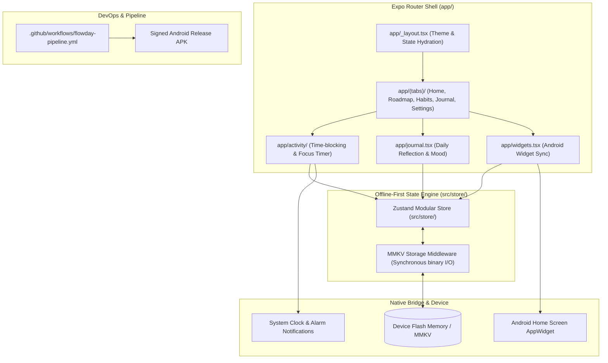

# 🏛️ Flowday Architecture & System Topology

Offline-first cross-platform mobile productivity, time-blocking, and habit tracking system built with React Native (Expo SDK 52 New Architecture), TypeScript, Zustand, and MMKV. Designed with zero cloud latency and an automated CI/CD pipeline for APK generation.

---

## 1. Technology Stack

| Layer | Technology | Details |
| :--- | :--- | :--- |
| **Framework** | React Native & Expo SDK 52 | React 18, React Native New Architecture (TurboModules & Fabric) |
| **Routing** | Expo Router v4 | File-based typed routing with stack layouts and modal sheets |
| **State & Storage** | Zustand & `react-native-mmkv` | Synchronous, memory-mapped key-value storage for offline-first resilience |
| **Styling** | NativeWind v4 (Tailwind CSS) | Utility-first responsive native styling with dark mode tokens |
| **Native Plugins** | Expo Config Plugins | Custom Android AppWidgets (`withAndroidWidgets.js`) |
| **CI/CD & DevOps** | GitHub Actions & EAS | Automated Android release pipeline compiling signed release APKs |

---

## 2. System Topology & Component Graph



---

## 3. Data Flow & Offline Storage Lifecycle

```mermaid
sequenceDiagram
    autonumber
    actor User as Mobile User
    participant Screen as UI Component (Expo Router)
    participant Store as Zustand Store
    participant MMKV as react-native-mmkv
    participant OS as Android / iOS File System

    User->>Screen: Completes habit / Logs time block
    Screen->>Store: dispatch action (completeHabit(id))
    Store->>Store: Compute updated habit streak & state
    Store->>MMKV: Persist serialized state slice
    MMKV->>OS: Synchronous memory-mapped write (0ms lag)
    Store-->>Screen: Re-render optimistic state
    Note over User,OS: Device can be rebooted or taken offline; state is instant and indestructible.
```

---

## 4. Directory Structure & Module Breakdown

```
flowday/
├── app/                      # Expo Router file-based screens
│   ├── _layout.tsx           # Global provider stack, splash screen & font loading
│   ├── (tabs)/               # Bottom tab navigation (Today, Habits, Timeline, Metrics)
│   ├── activity/             # Pomodoro focus session & time-block tracker
│   ├── habit/                # Habit creation, recurrence rules & streak inspector
│   ├── journal.tsx           # Daily gratitude & evening review modal
│   └── widgets.tsx           # Home screen widget configuration & preview
├── src/                      # Core business logic and shared primitives
│   ├── store/                # Zustand modular slices (habits, tasks, settings)
│   ├── components/           # Reusable native UI components (cards, buttons, charts)
│   ├── hooks/                # Custom React hooks (useTimer, useStreak, useTheme)
│   ├── utils/                # Date math, streak calculations & export helpers
│   ├── types/                # Strict TypeScript interfaces and schemas
│   └── constants/            # Design tokens, color schemes & animation configs
├── plugins/                  # Custom Expo config plugins
│   └── withAndroidWidgets.js # Android Glance widget native bridge
├── .github/workflows/        # Automated CI/CD
│   └── flowday-pipeline.yml  # Java 17 / Gradle automated APK compilation
├── app.json                  # Expo project manifest and bundle identifiers
├── metro.config.js           # Metro bundler config with NativeWind wrapper
├── tailwind.config.js        # Design tokens and Tailwind theme
└── package.json              # Dependencies and script definitions
```
